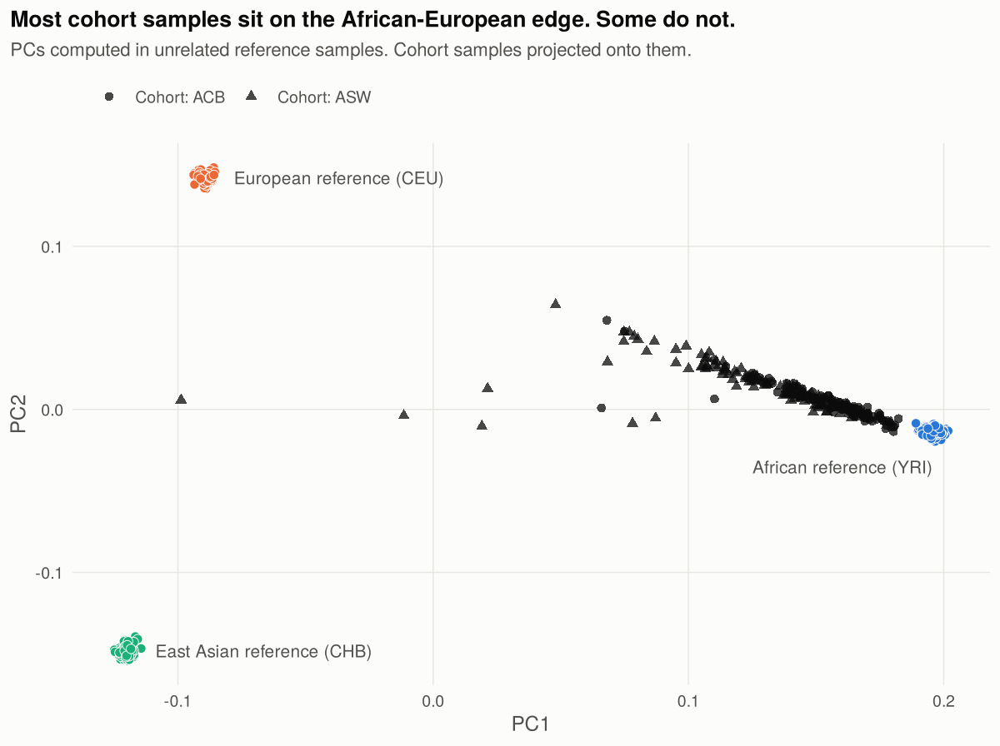
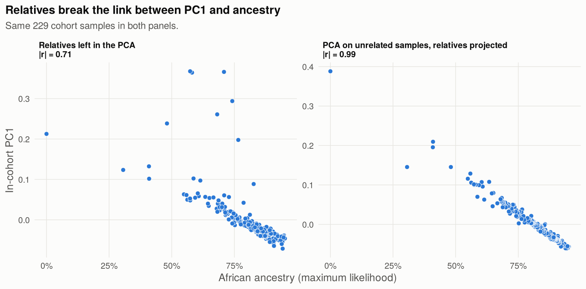
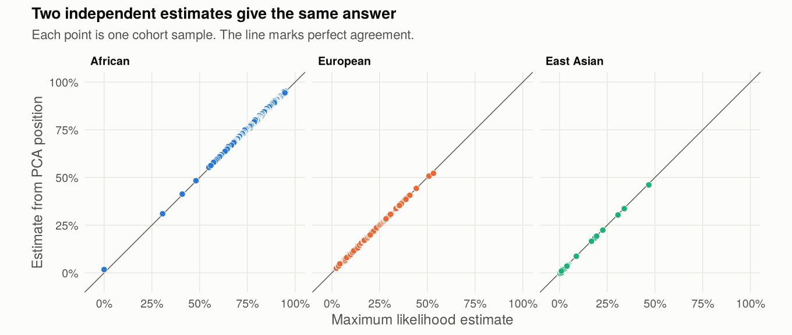
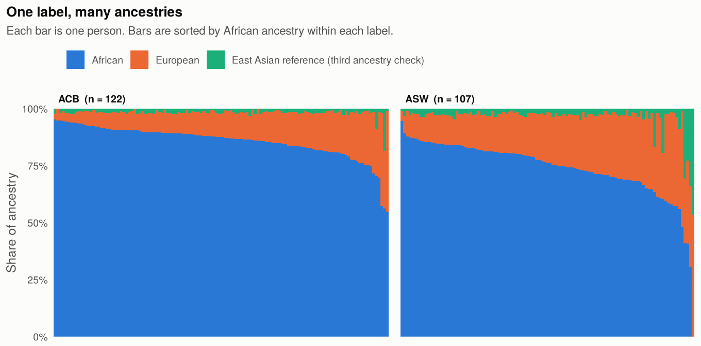

# Global ancestry and PCA for an admixed cohort, done right

A worked tutorial with PLINK 2 and R on public 1000 Genomes data.

You have genotypes from an admixed cohort. You need ancestry covariates for a GWAS or a PRS. Most tutorials show the commands. This one also shows what breaks, with real numbers from a real run.

**What you get at the end**

- Principal components you can use as GWAS covariates
- African, European and third-ancestry proportions for every sample
- Four diagnostic plots
- One covariate table, ready to merge with your phenotypes

**Time:** about 1 minute on 2 cores, after a 750 MB download.

**Level:** you can run a shell script and read R. No prior PCA experience needed.

---

## Quick start

```bash
git clone https://github.com/mrimis/admixed-ancestry-pca.git
cd admixed-ancestry-pca
bash run_all.sh
```

You need `plink2` and `R` (with `data.table` and `ggplot2`) on your PATH. Each step is also a separate script in `scripts/`, so you can run them one at a time and read along.

There is one optional extra step. If you have ADMIXTURE installed, `bash scripts/06_admixture_check.sh` cross-checks the ancestry estimates.

## The data

The 1000 Genomes Project genotyped its samples on the Affymetrix 6.0 array. That file is a good stand-in for a real study. It is genome-wide array data, it has missing calls, and it contains parents and children.

| Role | Groups | Samples |
|---|---|---|
| Cohort (our "study") | ACB (African Caribbean in Barbados), ASW (African ancestry in Southwest USA) | 229 |
| Reference | YRI (Yoruba), CEU (Utah, European ancestry), CHB (Han Chinese) | 470 |

The cohort is expected to be a two-way mix of African and European ancestry. CHB is in the reference as a check. It lets us see ancestry that a two-way model would miss.

`scripts/00_download.sh` fetches the VCF and the sample panel. Coordinates are GRCh37.

---

## Step 1. Import and QC

`scripts/01_import_qc.sh`

Keep autosomal biallelic SNPs. Then filter on missingness and allele frequency.

```bash
plink2 --vcf data/affy6.vcf.gz --keep work/all.ids \
  --chr 1-22 --snps-only just-acgt --max-alleles 2 \
  --set-missing-var-ids '@:#:$r:$a' --rm-dup exclude-all \
  --make-pgen --out work/raw

plink2 --pfile work/raw --geno 0.02 --maf 0.05 --make-pgen --out work/qc_variants
plink2 --pfile work/qc_variants --mind 0.02 --make-pgen --out work/qc
```

| | Variants |
|---|---|
| Imported | 868,632 |
| Removed for missingness above 2% | 23,715 |
| Removed for MAF below 5% | 88,519 |
| Left after QC | 756,398 |

### Mistake 1. A Hardy-Weinberg filter on pooled samples

Many QC recipes include `--hwe 1e-6`. On mixed-ancestry data that filter does damage.

When you pool groups with different allele frequencies, heterozygotes look too rare. This is the Wahlund effect. Good SNPs fail the test. The SNPs that fail are the ones that differ most between ancestries. Those are the SNPs PCA needs.

The script counts failures both ways.

| Samples tested | SNPs with HWE p < 1e-6 |
|---|---|
| All 699 samples pooled | 74,056 |
| YRI only | 106 |

A pooled filter would throw away about 10% of the data. Almost all of it is fine.

**Do this instead.** Test HWE inside one homogeneous group, such as controls of one ancestry. Or use a much looser threshold. Or skip the filter for the PCA step.

---

## Step 2. Relatives and LD

`scripts/02_relatedness_ld.sh`

### Find relatives

```bash
plink2 --pfile work/qc --make-king-table --king-table-filter 0.0884 --out work/king
plink2 --pfile work/qc --king-cutoff 0.0884 --out work/unrel
```

KING-robust kinship of 0.0884 is the usual line between second-degree and third-degree relatives. The first command lists the related pairs so you can read them. The second writes the list of samples to keep.

| | All samples | Unrelated |
|---|---|---|
| Cohort | 229 | 157 |
| Reference | 470 | 346 |

These 699 samples contain 380 related pairs. Most are parent and child. Three in four cohort samples have a close relative in the data.

### Prune for LD

```bash
plink2 --pfile work/qc \
  --keep work/unrel.king.cutoff.in.id \
  --exclude bed1 resources/high_ld_regions_grch37.txt \
  --indep-pairwise 500kb 0.1 \
  --out work/prune
```

This first drops 24 known regions of long-range LD, such as the HLA region and the chromosome 8 inversion. Then it prunes the rest. 73,452 variants remain.

Price and colleagues showed in 2008 that long-range LD can confound scans in admixed samples. A PC can lock onto one region and stop describing the genome.

An honest note. In this small cohort, skipping the step changed PC1 very little. The correlation between the pruned and unpruned PC1 was 0.997. Do not read that as permission. Larger cohorts resolve more PCs, and that is where region-driven PCs show up. Pruning costs seconds.

---

## Step 3. Two PCAs for two jobs

`scripts/03_pca.sh`

People often run one PCA and use it for everything. There are two different jobs here.

| Job | Compute PCs in | Then project | Use it for |
|---|---|---|---|
| A. Describe ancestry | Unrelated reference samples | Everyone | Plots, ancestry estimates, outlier checks |
| B. Adjust a GWAS | Unrelated cohort samples | The rest of the cohort | Covariates |

Reference PCs have a fixed meaning. They do not change when your cohort changes. Cohort PCs capture the structure that is actually in your study. That is what a covariate has to do.

### The projection recipe

```bash
# Compute PCs and save allele weights and allele counts
plink2 --pfile work/qc --keep work/ref_unrel.ids --extract work/prune.prune.in \
  --maf 0.01 --freq counts \
  --pca 10 allele-wts vcols=chrom,ref,alt \
  --out work/ref_pca

# Score every sample with those weights
plink2 --pfile work/qc --keep work/all.ids \
  --read-freq work/ref_pca.acount \
  --score work/ref_pca.eigenvec.allele 2 5 header-read no-mean-imputation variance-standardize \
  --score-col-nums 6-15 \
  --out work/ref_proj
```

This is the recipe from the PLINK 2 documentation.

### Mistake 2. Plotting `.eigenvec` and projected scores together

The `.eigenvec` file and the `.sscore` file are on different scales. In this run the reference PC1 runs from -0.076 to 0.047 in `.eigenvec`. The same samples run from -0.125 to 0.202 in `.sscore`, with the sign flipped. If you plot reference samples from one file and cohort samples from the other, the picture is wrong.

**Do this instead.** Score every sample with the same `--score` command, reference included. Use only the `.sscore` values.



Most cohort samples sit on the line between the African and European references. A sample's place on that line reflects its ancestry mix. A few samples sit off the line. We come back to them in step 4.

### Mistake 3. Leaving relatives in the PCA

PCA looks for the largest shared variation. A family shares a lot. So a family can take over a PC.

The script runs the cohort PCA both ways.

| | Correlation of PC1 with African ancestry |
|---|---|
| Relatives left in | 0.71 |
| Unrelated samples only, relatives projected | 0.99 |

With relatives in, PCs 3 to 8 were each one family. Three close relatives from one family sat at the top of each.



**Do this instead.** Compute PCs in unrelated samples. Project the relatives onto those PCs. Everyone gets a PC value. Nobody's family shapes the axes.

### Check what each PC is

Do not assume ten PCs means ten axes of ancestry.

| In-cohort PC | Eigenvalue | Correlation with African ancestry |
|---|---|---|
| PC1 | 1.90 | -0.986 |
| PC2 | 1.27 | 0.047 |
| PC3 | 1.22 | -0.025 |
| PC4 | 1.21 | -0.059 |
| PC5 | 1.16 | 0.023 |

Only PC1 stands clear of the rest, and only PC1 tracks ancestry. In this run the top three samples on PC2 had pairwise kinship of 0.03 to 0.08. Those are distant relatives. They fall under the 0.0884 cutoff, and in a cohort of 157 they are enough to own a PC.

What to do about it depends on your study. Adding a few extra PCs as covariates costs little. For close and distant relatedness together, use a mixed model for the GWAS. For PCs that are robust to relatedness in admixed samples, look at PC-AiR and PC-Relate in the GENESIS package.

---

## Step 4. Global ancestry, two ways

`scripts/04_ancestry.R`

**Method 1. From the PCA.** In PC space an admixed sample sits between its source groups. Its position between the three reference centres gives three weights that sum to 1. This takes a few lines of linear algebra.

**Method 2. Maximum likelihood.** Take the allele frequencies in each reference group. For one sample, find the ancestry proportions that make its genotypes most likely. This is the same likelihood ADMIXTURE uses, with the reference frequencies held fixed. It is about 20 lines of base R, so you can read exactly what it does.

The two methods share no code. They agree.

| Ancestry | Correlation between methods |
|---|---|
| African | 0.9996 |
| European | 0.9997 |
| Third component | 0.9984 |



### Optional. Cross-check with ADMIXTURE

`scripts/06_admixture_check.sh`

If you have ADMIXTURE installed, this step runs it in supervised mode with K = 3 and compares the result with Method 2.

```bash
admixture --supervised admix.bed 3 -j2
```

ADMIXTURE assumes unrelated samples, so the check uses the 157 unrelated cohort samples.

| Ancestry | Correlation with Method 2 | Mean difference |
|---|---|---|
| African | 0.9999 | 1.7 points |
| European | 0.9999 | 0.7 points |
| Third component | 0.9989 | 1.0 points |

The ranking of samples is the same. ADMIXTURE puts African ancestry about 1.7 points higher on average. A likely reason is that ADMIXTURE also learns allele frequencies from the cohort samples. Method 2 holds them at the YRI, CEU and CHB values. No reference group is a perfect match for the true source populations, so small shifts like this are expected.

### Mistake 4. Using the population label as ancestry

| Label | n | Mean African ancestry | Lowest | Highest |
|---|---|---|---|---|
| ACB | 122 | 85.8% | 54.9% | 95.2% |
| ASW | 107 | 74.0% | 0.0% | 94.7% |



Two people with the same label can differ by 40 points of African ancestry. A label is a category. Ancestry is a number that varies from person to person. If your model needs ancestry, estimate it.

### Mistake 5. Assuming two-way admixture without checking

We expected African and European ancestry only. The third reference group says otherwise for some samples.

Nine cohort samples have more than 5% of the third component. One ASW sample has almost no African ancestry at all. It is about half European and half third component.

These are the samples that sit off the line in the first figure.

The East Asian reference is a stand-in here. It catches ancestry that is neither African nor European. In ASW that is most likely Native American ancestry. East Asian is the closest group in this file, so it picks up part of it. The proportions for these samples are rough. The flag is the useful part.

**Do this instead.** Always include one reference group you do not expect to need. Then decide what to do with the flagged samples. You can model a third ancestry, or set those samples aside, or run a sensitivity analysis.

---

## The output

`results/cohort_ancestry_covariates.tsv` has one row per cohort sample.

| Column | Meaning |
|---|---|
| `IID` | Sample ID |
| `POP` | Population label from the panel |
| `UNRELATED` | 1 if the sample was in the unrelated set |
| `AFR`, `EUR`, `EAS` | Ancestry proportions, maximum likelihood |
| `AFR_PC`, `EUR_PC`, `EAS_PC` | Ancestry proportions from PCA position |
| `PC1` to `PC10` | In-cohort PCs, for use as covariates |

`scripts/05_plots.R` draws the four figures.

## Checklist for your own data

1. Do not filter on HWE in pooled mixed-ancestry samples.
2. Remove known long-range LD regions, then prune.
3. Compute PCs in unrelated samples. Project the relatives.
4. Keep two PCAs apart: reference PCs to describe, cohort PCs to adjust.
5. Score reference and cohort with the same command before you plot them together.
6. Check what each PC tracks before you call it ancestry.
7. Estimate ancestry. Do not read it from a label.
8. Include a reference group you do not expect to need.

## What this tutorial leaves out

This is the first step of a longer pipeline. It does not cover:

- Merging your own array data with a reference panel (builds, strand flips, ambiguous SNPs)
- Three-way admixture with a proper Native American reference
- Local ancestry inference
- GWAS models that use local ancestry
- Polygenic scores in admixed samples

I am building a full toolkit that covers these steps, with tested scripts and worked examples on public data. I will only build it if enough people need it.

**If it would save you time, join the waitlist: <WAITLIST_LINK>**

It takes one minute. It also asks what you are stuck on, so I build the right thing.

## Tested with

| | Linux | macOS |
|---|---|---|
| System | Ubuntu 24.04, x86-64 | Apple Silicon |
| PLINK | v2.00a6 (23 Nov 2023) | v2.00a5.12 (25 Jun 2024) |
| R | 4.3.3 with data.table and ggplot2 | 4.3.1 with data.table and ggplot2 |
| ADMIXTURE (optional step) | 1.4.0 | 1.3.0 |

Both setups gave the same results for steps 1 to 5. Every number and figure on this page comes from the Linux run.

## References

- 1000 Genomes Project Consortium (2015). A global reference for human genetic variation. *Nature*.
- Chang CC, et al. (2015). Second-generation PLINK: rising to the challenge of larger and richer datasets. *GigaScience*.
- Manichaikul A, et al. (2010). Robust relationship inference in genome-wide association studies. *Bioinformatics*.
- Price AL, et al. (2008). Long-range LD can confound genome scans in admixed populations. *American Journal of Human Genetics*.
- McVean G (2009). A genealogical interpretation of principal components analysis. *PLoS Genetics*.
- Alexander DH, Novembre J, Lange K (2009). Fast model-based estimation of ancestry in unrelated individuals. *Genome Research*.
- Conomos MP, Miller MB, Thornton TA (2015). Robust inference of population structure for ancestry prediction and correction of stratification in the presence of relatedness. *Genetic Epidemiology*.
- Conomos MP, et al. (2016). Model-free estimation of recent genetic relatedness. *American Journal of Human Genetics*.
- Wang C, et al. (2015). Improved ancestry estimation for both genotyping and sequencing data using projection Procrustes analysis and genotype imputation. *American Journal of Human Genetics*.
- Long-range LD region list: [Genome Analysis Wiki, University of Michigan](https://genome.sph.umich.edu/wiki/Regions_of_high_linkage_disequilibrium_(LD))
- Projection recipe: [PLINK 2 documentation, PCA projection with --score](https://www.cog-genomics.org/plink/2.0/score)

## License

Code is released under the MIT License. See `LICENSE`.

## Author

Mrinal Mishra
